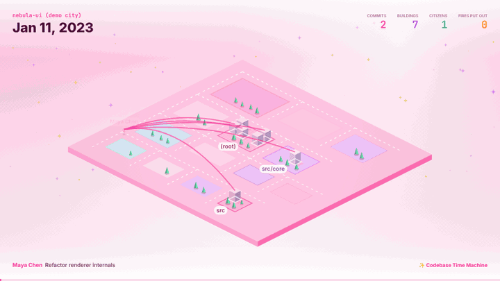
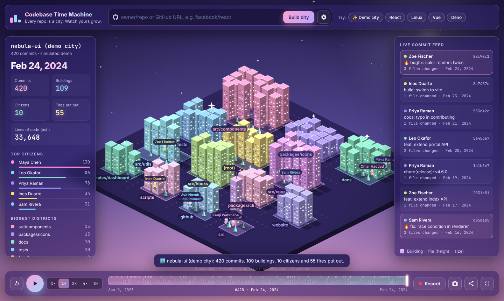

<div align="center">

# 🏙️ Codebase Time Machine

### Point it at any GitHub repo and watch a city grow, commit by commit.

**Buildings are files. Fires are bugs. People are contributors.**

[**▶ Live demo**](https://anushka180712.github.io/Codebase-TimeMachine/) · [Features](#-features) · [Quick start](#-quick-start) · [How it works](#-how-it-works) · [Share it](#-share-it-on-linkedin)




</div>

---

Every codebase has a story. The first lonely commit. The week the team doubled. The refactor that knocked down half a neighbourhood. The 2 a.m. hotfix that put out a fire.

**Codebase Time Machine turns that story into a living isometric city.** Type `facebook/react` or `torvalds/linux`, press play, and watch skyscrapers rise out of the commit history while contributors stroll between the buildings they're working on and bug fixes light up the skyline in flames.



## ✨ Features

| | |
|---|---|
| 🏗️ **Files become buildings** | Every file gets its own lot. Height grows with lines of code (or switch to *churn* to see the most edited files tower over the rest). |
| 🗺️ **Folders become districts** | Top-level folders (and `packages/*`, `src/*`, `apps/*` in monorepos) become colour-coded neighbourhoods with roads in between. |
| 🔥 **Bug fixes start fires** | Commits mentioning `fix`, `bug`, `crash`, `hotfix`, `regression`, `leak` and friends set the touched buildings ablaze. When the fire is out, the building sparkles. |
| 🚶 **Contributors walk the streets** | Each author is a little citizen who walks to the building they just changed, with a light beam marking the commit. |
| ⏯️ **Full playback control** | Play, pause, restart, step commit by commit, scrub a timeline that shows activity and bug hotspots, and pick ½× to 8× speed. |
| 📊 **Live stats** | Date, commits, buildings, citizens, fires put out, estimated lines of code, a contributor leaderboard and the biggest districts, all updating in real time. |
| 📰 **Live commit feed** | Scrolling feed of commit messages with links back to GitHub. |
| 🎬 **One-click video recording** | Hit **Record** and the app replays the whole history and downloads an MP4/WebM, with a cinematic overlay baked in. Ready to post. |
| 🎥 **Cinema mode** | Press `C` to hide the UI for clean screen recordings, with stats drawn right onto the scene. |
| 📸 **Screenshots & share links** | Save a PNG, or copy a link like `?repo=vuejs/core` that opens straight into that city. |
| ⚡ **Works instantly, no token** | A built-in demo city plays with zero API calls. Real repos use the public GitHub API, and an optional token unlocks thousands of commits. |
| 🌸 **Dreamy pastel look** | Cotton-candy dusk skies, pastel skyscrapers with glowing windows, and sparkles that burst when a new file is built or a bug fire is put out. Switch to a bright daytime sky in Settings. |
| 📱 **Responsive** | Drag to pan, scroll or pinch to zoom, works on phones too. |

## 🚀 Quick start

### Use it online

Open the **[live demo](https://anushka180712.github.io/Codebase-TimeMachine/)**, type a repo (for example `facebook/react`) and click **Build city**.

### Run it locally

No install, no build. It's plain HTML, CSS and JavaScript.

```bash
git clone https://github.com/Anushka180712/Codebase-TimeMachine.git
cd Codebase-TimeMachine

# any static server works, for example:
python3 -m http.server 8000
# or
npx serve .
```

Then open **http://localhost:8000**. You can even just double-click `index.html`.

### Deploy your own copy on GitHub Pages (free, about 1 minute)

1. Fork or push this repo to your GitHub account.
2. Go to **Settings → Pages**.
3. Under **Build and deployment**, set **Source** to **Deploy from a branch**, pick **`main`** and **`/ (root)`**, then click **Save**.
4. Wait a minute and your city lives at `https://<your-username>.github.io/<repo-name>/`.

## 🔑 GitHub token (optional)

Without a token GitHub allows **60 API requests per hour**, which is enough for about **50 commits**. To build bigger cities:

1. Create a token at **[github.com/settings/tokens](https://github.com/settings/tokens?type=beta)** (a fine-grained token with *public repositories, read-only* access is perfect, no extra permissions needed).
2. Click the ⚙️ button in the app and paste it.
3. Raise **How many commits** to 300, 500 or more.

The token stays in your browser and is only ever sent to `api.github.com`. It's saved only if you tick *Remember token*.

## 🧠 How it works

```
GitHub REST API ──► commit list ──► per-commit file changes ──► city plan ──► replay engine ──► canvas renderer
```

1. **Fetch.** The app lists commits (100 per request). In *"The beginning"* mode it jumps to the last page of history and walks forward, so you see a project being founded. In *"The latest"* mode it takes recent history. Each commit is then fetched once to learn which files it added, changed, renamed or deleted, six at a time in parallel. Merge commits stay on the timeline but aren't fetched, which saves rate limit.
2. **Plan the city.** Every file that ever existed gets a permanent lot, grouped into districts by folder and packed into a roughly square map with roads between blocks. Because the full plan is computed up front, buildings never jump around as the city grows.
3. **Replay.** A tiny replay engine applies commits one by one, tracking each file's estimated size (`+additions − deletions`), edit count and last author. Scrubbing replays from the start, which takes milliseconds even for thousands of commits.
4. **Render.** A hand-written isometric renderer on HTML5 Canvas draws buildings back to front with lit windows, shadows, particle fire and smoke, demolition dust, walking citizens and an auto-following camera that zooms out as the city expands.
5. **Record.** `canvas.captureStream()` + `MediaRecorder` turn the animation into a video file right in the browser.

Results are cached in `localStorage`, so reopening the same repo is instant. You can also **export** a city as JSON and **import** it later, or share it with someone who has no token.

### Project structure

```
index.html        page layout and controls
css/style.css     pastel glass UI
js/github.js      GitHub API loader (pagination, rate limits)
js/demo.js        seeded demo project that works offline
js/model.js       city planner + replay engine + bug detection
js/city.js        isometric canvas renderer, particles, people, camera
js/app.js         playback loop, UI panels, recording, sharing
```

### Keyboard shortcuts

| Key | Action |
|---|---|
| `Space` | Play / pause |
| `←` `→` | Step one commit |
| `R` | Restart |
| `+` `-` | Faster / slower |
| `C` | Cinema mode |
| `S` | Screenshot |
| Double-click | Camera follows the city again |

## 💼 Share it on LinkedIn

The fastest way to a post people stop scrolling for:

1. Open the app, load a famous repo (React, Linux, Vue, or your own project) and click **Record**.
2. Grab the downloaded video and upload it straight to LinkedIn.
3. Write a caption, for example:

> I built a time machine for codebases. 🏙️
>
> Point it at any GitHub repo and it replays the entire history as a growing city: every file is a building, every bug fix sets one on fire, and every contributor is a person walking the streets.
>
> Here's React being built, commit by commit. 👇
>
> No frameworks, no build step, just Canvas and the GitHub API.
> Try it on your own repo: https://anushka180712.github.io/Codebase-TimeMachine/
>
> #opensource #javascript #webdev #dataviz #github

**Tips:** Your own side project makes the most personal post. Cinema mode (`C`) plus 2× speed gives the cleanest recording. For square videos, resize the browser window to a square before recording.

## 🛣️ Ideas for the future

- Weather that reflects CI status
- Contributor avatars as citizens
- Sound design, with a construction hum and sirens on hotfixes
- Compare two repos side by side

## 📄 License

[MIT](LICENSE) © Udisha Singh
